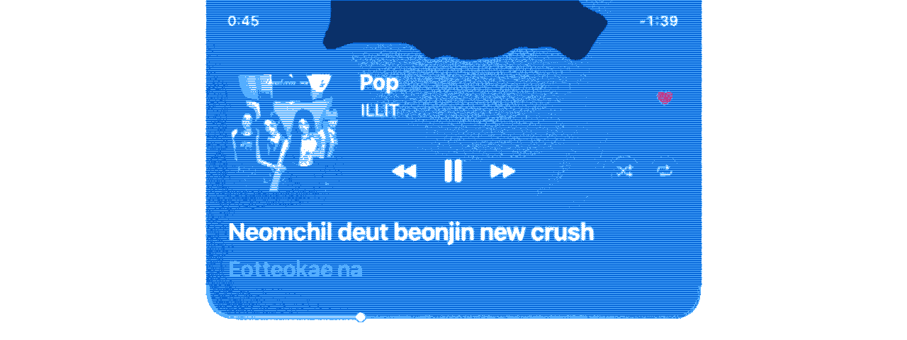
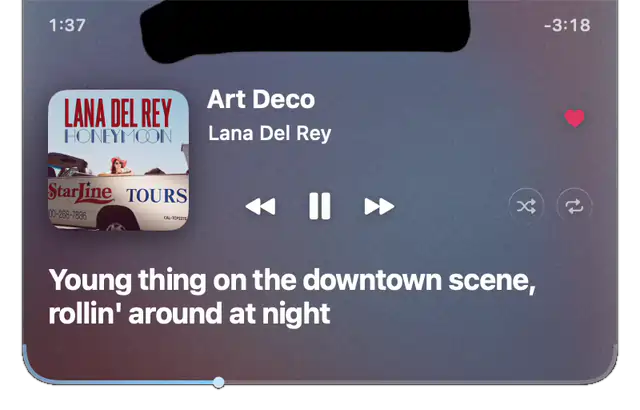
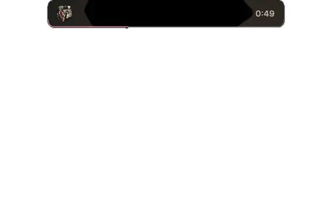
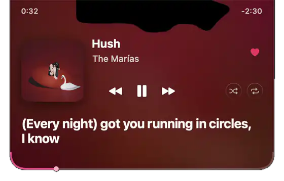
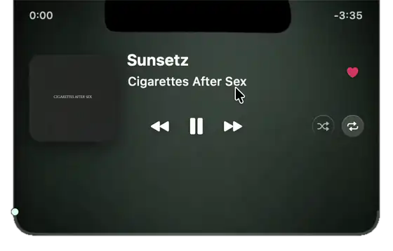
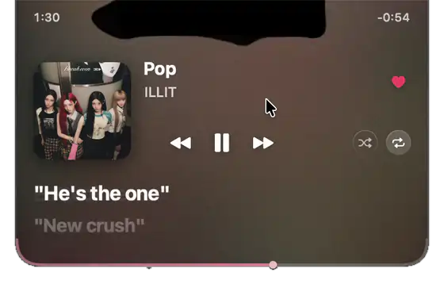
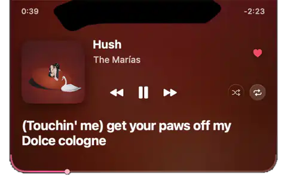

<p align="center">
  <picture>
    <source media="(max-width: 600px) and (prefers-color-scheme: dark)" srcset="docs/media/banner-phone-dark.webp">
    <source media="(max-width: 600px)" srcset="docs/media/banner-phone-light.webp">
    <source media="(prefers-color-scheme: dark)" srcset="docs/media/banner-dark.webp">
    
  </picture>
</p>

<h1 align="center">Magnetite</h1>

<p align="center">Spotify and Apple Music in your MacBook notch, with black ferrofluid that moves to the music.<br>Free and open source.</p>

<p align="center"><a href="https://github.com/scryst/magnetite-releases/releases/latest"><b>Download for Mac</b></a><br>744 KB. Needs macOS 26 on Apple silicon.</p>

<p align="center">
  
</p>

## Hover to open

Bring the pointer to the notch and the player unfolds out of it. Move away and it folds back. Featured artists show beside the lead, and each name opens that artist in Spotify or Music.

<p align="center">
  
</p>

## The ink plays the music

The outline around the notch is a ferrofluid simulation driven by whatever your Mac is playing. Each hit flows out, eases to a stop and drains back.

<p align="center">
  
</p>

## Swipe to skip

Two fingers sideways change the track. Up or down plays or pauses.

<p align="center">
  
</p>

## Drag the edge to seek

The player's bottom outline is the progress bar. Drag along it to move through the song.

<p align="center">
  
</p>

## Lyrics in time

Synced lyrics from LRCLIB scroll under the controls, line by line. Turn them off in the **M** menu.

<p align="center">
  
</p>

## Folded, it stays out of the way

Closed, the player is a strip either side of the camera: the cover on one side, the time on the other. Turn off **Mini Player When Closed** in the **M** menu for a bare notch.

<p align="center">
  
</p>

Every loop on this page is a screen recording of the shipping app. The songs are “Pop” by ILLIT, “Sunsetz” by Cigarettes After Sex, “Art Deco” by Lana Del Rey and “Hush” by The Marías.

## Install

1. [Download the ZIP](https://github.com/scryst/magnetite-releases/releases/latest), drag **Magnetite** to Applications and double-click it.
2. macOS says it can't verify Magnetite. Click **Done**, not Move to Trash. A free app outside Apple's paid program gets this warning.
3. Open **System Settings → Privacy & Security**, scroll to **Security** and click **Open Anyway** next to Magnetite and enter your password.
4. Look for the **M** in the menu bar. Play something in Spotify or Music, hover the notch and allow the two prompts: one to control the player, one to record system audio for the ink.

You do this once. Magnetite is ad-hoc signed and not notarized by Apple, so only open a copy you downloaded from here. Builds are published in [scryst/magnetite-releases](https://github.com/scryst/magnetite-releases/releases), with every version and its checksum; this repository holds the source.

Or [read the installer](install.sh) and run it in Terminal:

```sh
curl -fsSL https://magnetite.app/install.sh | sh
```

It downloads the release it is pinned to, checks it against the fingerprint built into the installer and its code signature, installs into `/Applications` (or `~/Applications`) and opens the app. Run it again to update.

## Requirements

- macOS 26 or later on Apple silicon. Intel Macs and earlier macOS versions are not supported.
- The Spotify or Apple Music desktop app for the controls. The ink follows any sound your Mac plays.
- A MacBook with a notch is its home. Other displays get a floating pill.

## Privacy and permissions

No account, analytics, telemetry or crash reporter. Audio is processed in memory on your Mac and never saved or uploaded.

- **Automation (Apple Events):** reads what is playing and controls the local Spotify or Music app. Everyday playback needs no Spotify Web API connection.
- **System audio recording:** a CoreAudio process tap reads the system mix for the ink. It never records the microphone.
- **Artwork:** fetches the current cover from the URL the music player gives, and takes the interface's colors from it.
- **Lyrics:** sends the track's title, artist, album and length to [LRCLIB](https://lrclib.net), and the title and artist to [NetEase Cloud Music](https://music.163.com) when LRCLIB has none or is down. Answers are cached under `~/Library/Application Support/Magnetite/Lyrics`. Turn off **Lyrics in Player** in the **M** menu to stop lookups.
- **Optional Spotify connection:** `user-library-read` and `user-library-modify` for liked songs, `user-read-playback-state` and `user-modify-playback-state` for shuffle and repeat, `user-read-private` to check the account before offering them.

Spotify sign-in uses PKCE without a client secret. Its refresh token is kept in an owner-only (`0600`) file under `~/Library/Application Support/Magnetite`; disconnecting deletes it. Preferences stay in macOS UserDefaults. [Full privacy details](https://magnetite.app/privacy.html).

## FAQ and troubleshooting

To report a bug, choose **Copy Diagnostics** in the **M** menu right after it happens and paste the result into a [bug report](https://github.com/scryst/magnetite/issues/new?template=bug_report.md). It holds the version, macOS, the music source and the last 200 log lines, with your name, folders, computer name and the song left out.

<details>
<summary><b>macOS blocked the first launch. What now?</b></summary>

Follow the numbered steps under [Install](#install): double-click the app, click **Done**, then use **System Settings → Privacy & Security → Open Anyway**. The build is not notarized by Apple, which is why macOS asks. The Terminal installer downloads with `curl`, which does not add browser quarantine; it still checks the checksum and code signature. You do not need to disable Gatekeeper system-wide.

</details>

<details>
<summary><b>There is no track, or the liquid is still.</b></summary>

Open Spotify or Music and start a track on this Mac. Check the selected music source in Magnetite's **M** menu. In **System Settings → Privacy & Security → Automation**, allow Magnetite to control that player. For the visualizer, enable Magnetite under **Screen & System Audio Recording** (the label may vary with macOS), then quit and reopen Magnetite. Audio permission and playback permission are separate.

</details>

<details>
<summary><b>Do I need to connect Spotify?</b></summary>

Not for everyday listening: play, pause, skip, seek and the visualizer work with the Spotify desktop app, and Apple Music needs nothing extra. Liked songs, shuffle and repeat need a free Spotify developer app of your own, which takes a few minutes. To connect, choose **Connect Spotify Library…**, create an app in the [Spotify developer dashboard](https://developer.spotify.com/dashboard) with **Web API** and redirect URI `http://127.0.0.1:8888/callback`, then enter its Client ID. Apple Music favorites need no Spotify setup.

</details>

<details>
<summary><b>Does it work without a notch or in fullscreen?</b></summary>

Notchless displays get a floating pill. It hides on lock, screensaver and detected fullscreen, per display. Automatic menu-bar hiding limits fullscreen detection; Mission Control is not handled. Calibrate the notch from the **M** menu if the shape does not match your hardware.

</details>

<details>
<summary><b>How do I update or uninstall?</b></summary>

Rerun the installer or replace the app with the latest release. To uninstall, disconnect Spotify if connected, quit from the **M** menu, then delete Magnetite.app. Optional settings cleanup: remove `~/Library/Application Support/Magnetite` and run `defaults delete app.magnetite.Magnetite` in Terminal.

</details>

## Build from source

Requires macOS 26+, Apple silicon and the Command Line Tools (`xcode-select --install`). No Xcode project is needed.

```sh
git clone https://github.com/scryst/magnetite.git
cd magnetite
./build.sh release
open build.noindex/Magnetite.app
```

To build and install into Applications instead, use `./install.sh --from-source`.

## Guides

- [Music player in the MacBook notch](https://magnetite.app/music-player-macbook-notch.html)
- [Control Spotify or Apple Music from the notch](https://magnetite.app/spotify-apple-music-controls-notch.html)
- [Synced lyrics in the MacBook notch](https://magnetite.app/lyrics-macbook-notch.html)
- [Open an app from an unidentified developer on Mac](https://magnetite.app/open-unidentified-developer-mac.html)

## Contributing

[Bug reports and focused pull requests](CONTRIBUTING.md) are welcome. [PRODUCT.md](PRODUCT.md) has the design principles and [APP.md](APP.md) explains how the app is built. Run `./check.sh` before a PR; [engineering notes](docs/ENGINEERING.md) explain focused checks and release tooling. Report vulnerabilities privately using [SECURITY.md](SECURITY.md).

## License

[MIT](LICENSE). The Geist font uses the [SIL Open Font License](site/fonts/OFL-Geist.txt). See [media provenance](docs/media/README.md) for the films and loops.
