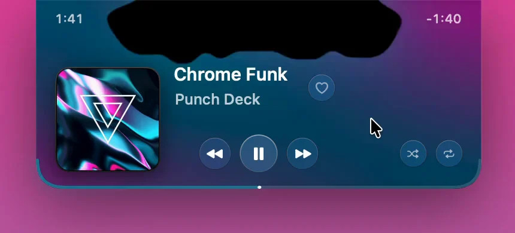
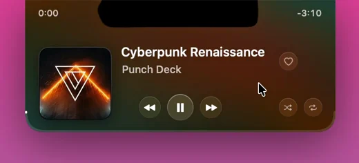
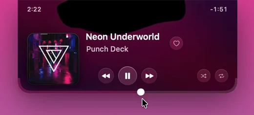
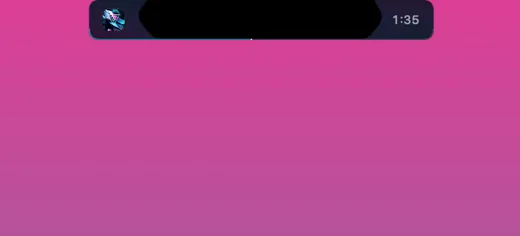

# Magnetite

Free, open-source Spotify and Apple Music controls in your MacBook notch, with ferrofluid that moves to your music.

[](https://magnetite.app/media/film.mp4)

[](https://github.com/scryst/magnetite-releases/releases/latest) [](#requirements) [](LICENSE)

## Install

**[Download the latest release](https://github.com/scryst/magnetite-releases/releases/latest)**, unzip it, and drag **Magnetite.app** into Applications.

The current build is ad-hoc signed and **not Apple-notarised**. After trying to open it, approve it in **System Settings → Privacy & Security → Open Anyway**, only if you trust the download.

Or [read the installer](install.sh), then run it in Terminal:

```sh
curl -fsSL https://magnetite.app/install.sh | sh
```

The installer checks the published SHA-256 and code signature, installs into `/Applications` (or `~/Applications` if needed), and opens the app. Those checks verify integrity, not Apple notarisation. Run it again to update.

Start music in Spotify or Music, then **hover the notch**. The **M** in the menu bar holds settings and Quit.

## See what it does

These are frames from the [31-second recording of the real app](https://magnetite.app/media/film.mp4), not interface mockups. Follow a frame to watch the behavior.

### Music becomes liquid

One black surface responds to system audio around familiar playback controls.

[](https://magnetite.app/media/film.mp4#t=0,6)

### Skip with a swipe

Two fingers sideways change tracks; up or down plays or pauses.

[](https://magnetite.app/media/film.mp4#t=1,10)

### Seek on the edge

Drag the player's bottom outline to move through a track.

[](https://magnetite.app/media/film.mp4#t=17,20)

### Back into the menu bar

Move away and the player retracts; hover to open it again.

[](https://magnetite.app/media/film.mp4#t=21,31)

Film: [Punch Deck](https://punchdeck.bandcamp.com)'s “Chrome Funk,” “Cyberpunk Renaissance” and “Neon Underworld,” [CC BY 4.0](https://creativecommons.org/licenses/by/4.0/). Frames are cropped from that recording; see [media provenance](docs/media/README.md).

## Requirements

- **macOS 26 or later, Apple silicon.** Intel Macs and earlier macOS versions are unsupported.
- **Spotify or Apple Music desktop app** for playback controls. The visualiser responds to system audio.
- A notched MacBook is the intended home. Displays without a notch use a floating pill.

## Privacy and permissions

No Magnetite account, analytics, telemetry or crash reporter. Audio is processed in memory on your Mac; it is never saved or uploaded.

- **Automation / Apple Events** (the same macOS permission used by AppleScript): reads now-playing information and controls the local Spotify or Music app through ScriptingBridge. Ordinary playback needs no Spotify Web API connection.
- **System audio recording:** a CoreAudio process tap reads the system mix for the ferrofluid visualiser. It does not record your microphone or upload audio.
- **Artwork downloads:** fetches the current cover from the URL supplied by the music player, then uses its colours in the interface.
- **Optional Spotify connection:** `user-library-read` and `user-library-modify` read/save/remove liked tracks; `user-read-playback-state` and `user-modify-playback-state` support shuffle/repeat; `user-read-private` checks account capability before offering those controls.

Spotify authorization uses PKCE, without a client secret. Its refresh token is kept in an owner-only (`0600`) file under `~/Library/Application Support/Magnetite`; disconnecting deletes it. Preferences stay in macOS UserDefaults. Spotify receives authorized API requests; artwork hosts receive image requests. [Full privacy details](https://magnetite.app/privacy.html).

## FAQ and troubleshooting

<details>
<summary><b>macOS blocked the first launch. What now?</b></summary>

For a ZIP from the official Releases page, try opening the app, then use **System Settings → Privacy & Security → Open Anyway**. The current build is not notarised. The Terminal installer downloads with `curl`, which does not add browser quarantine; it still checks the checksum and code signature. You do not need to disable Gatekeeper system-wide.

</details>

<details>
<summary><b>There is no track, or the liquid is still.</b></summary>

Open Spotify or Music and start a track on this Mac. Check the selected music source in Magnetite's **M** menu. In **System Settings → Privacy & Security → Automation**, allow Magnetite to control that player. For the visualiser, enable Magnetite under **Screen & System Audio Recording** (the label may vary with macOS), then quit and reopen Magnetite. Audio permission and playback permission are separate.

</details>

<details>
<summary><b>Do I need to connect Spotify?</b></summary>

Only for library and additional Web API controls. Basic playback uses the desktop app. To connect, choose **Connect Spotify Library…**, create an app in the [Spotify developer dashboard](https://developer.spotify.com/dashboard) with **Web API** and redirect URI `http://127.0.0.1:8888/callback`, then enter its Client ID. Spotify's current developer-account restrictions apply. Apple Music favourites need no Spotify setup.

</details>

<details>
<summary><b>Does it work without a notch or in fullscreen?</b></summary>

Notchless displays get a floating pill. It hides on lock, screensaver and detected fullscreen, per display. Automatic menu-bar hiding limits fullscreen detection; Mission Control is not handled. Calibrate the notch from the **M** menu if the shape does not match your hardware.

</details>

<details>
<summary><b>How do I update or uninstall?</b></summary>

Rerun the installer or replace the app with the latest release. To uninstall, disconnect Spotify if connected, quit from the **M** menu, then delete Magnetite.app. Optional settings cleanup: remove `~/Library/Application Support/Magnetite` and run `defaults delete com.laks.magnetite` in Terminal.

</details>

## Build from source

Requires macOS 26+, Apple silicon and the Command Line Tools (`xcode-select --install`). No Xcode project is needed.

```sh
git clone https://github.com/scryst/magnetite.git
cd magnetite
./build.sh release
open build.noindex/Magnetite.app
```

To build and install into Applications instead, use `./install.sh --from-source`.

## Contributing

[Bug reports and focused pull requests](CONTRIBUTING.md) are welcome. Read [PRODUCT.md](PRODUCT.md) before visual changes and [APP.md](APP.md) for the design and architecture. Run `./check.sh` before a PR; [engineering notes](docs/ENGINEERING.md) explain focused checks and release tooling. Report vulnerabilities privately using [SECURITY.md](SECURITY.md).

## Licence

[MIT](LICENSE). The demo soundtrack and its artwork are credited under [CC BY 4.0](https://creativecommons.org/licenses/by/4.0/); the Gloock font uses the [SIL Open Font License](site/fonts/OFL-Gloock.txt).
